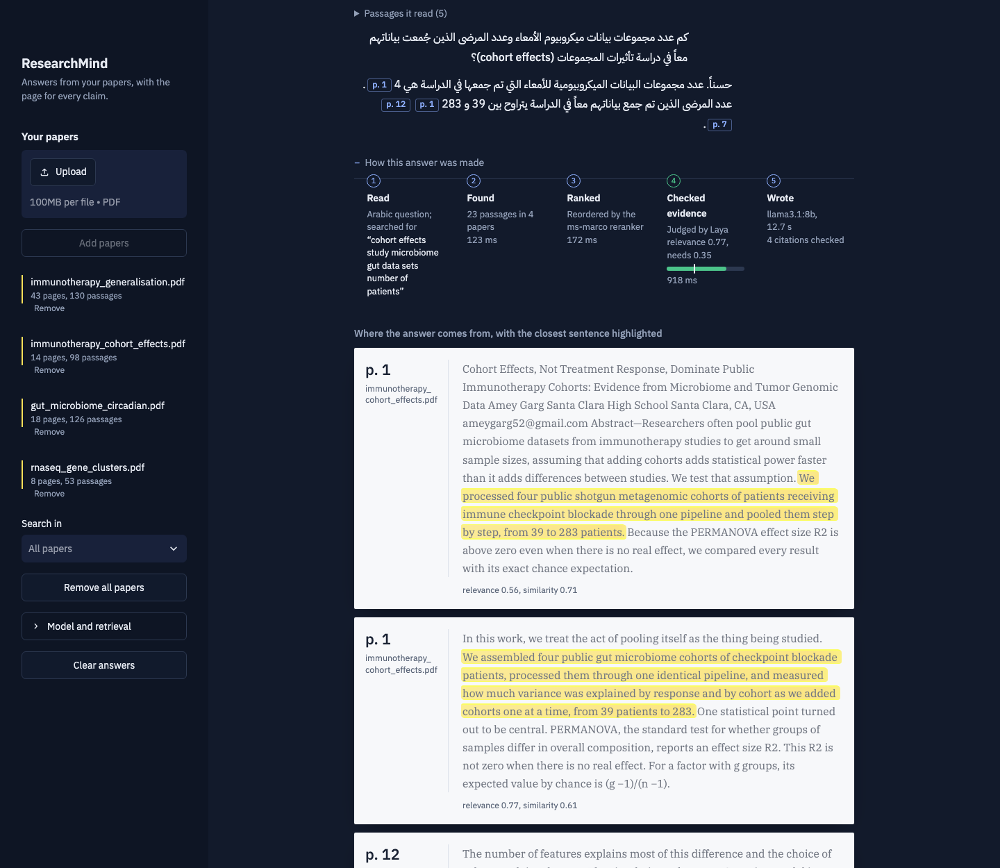
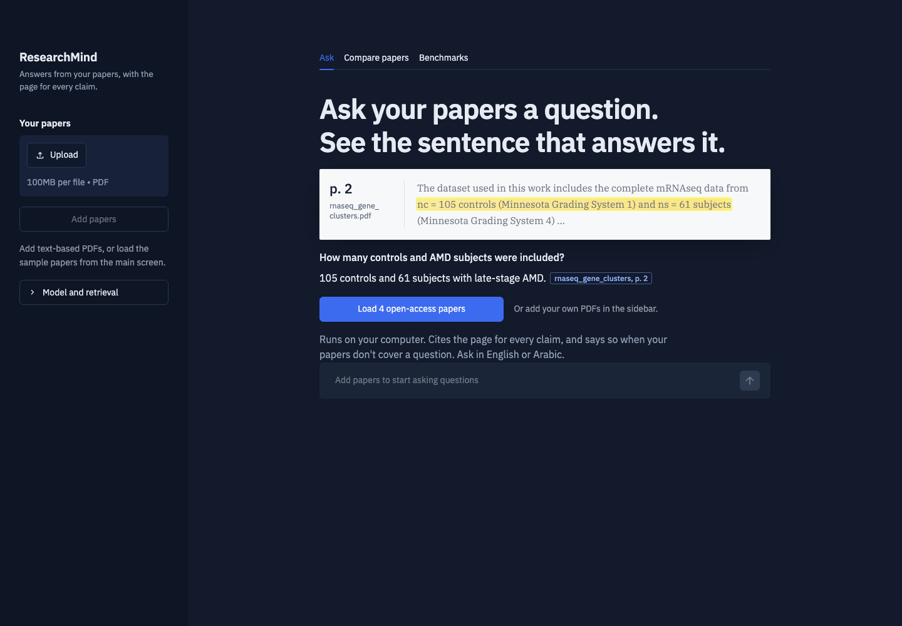
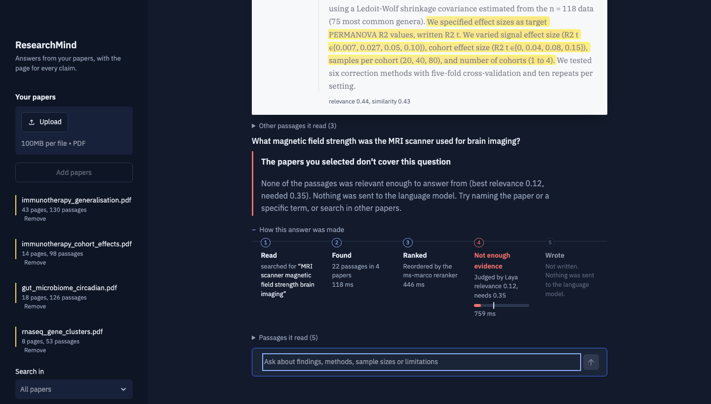
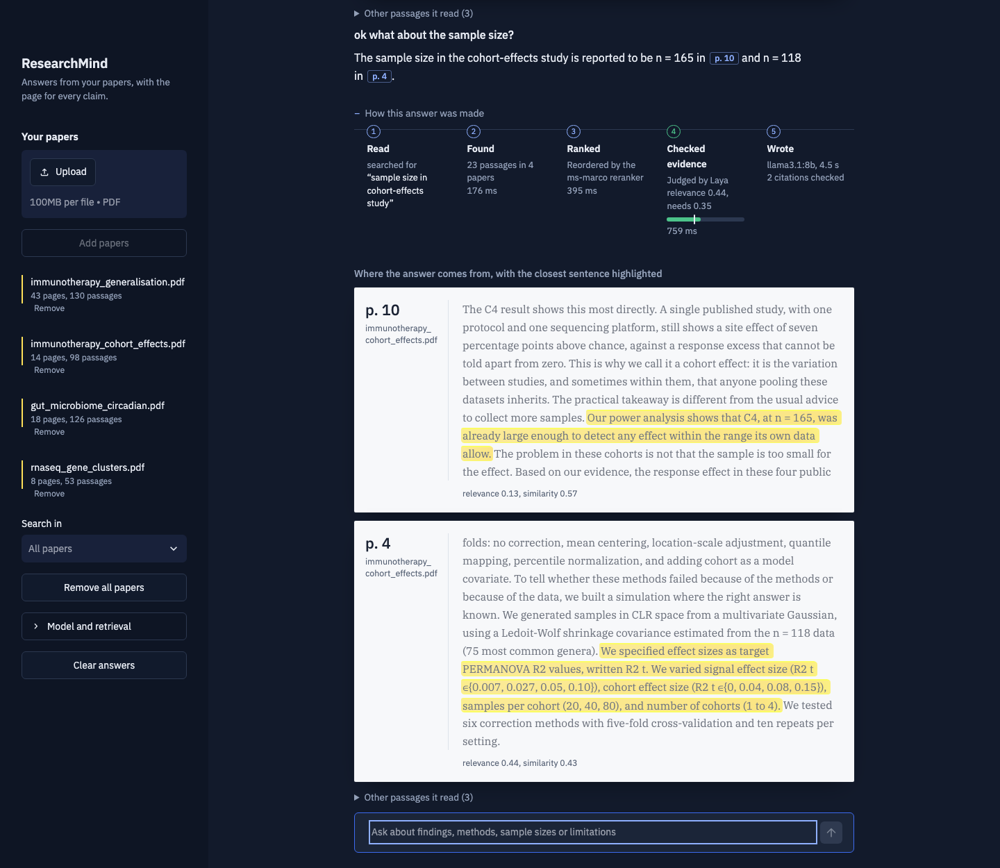
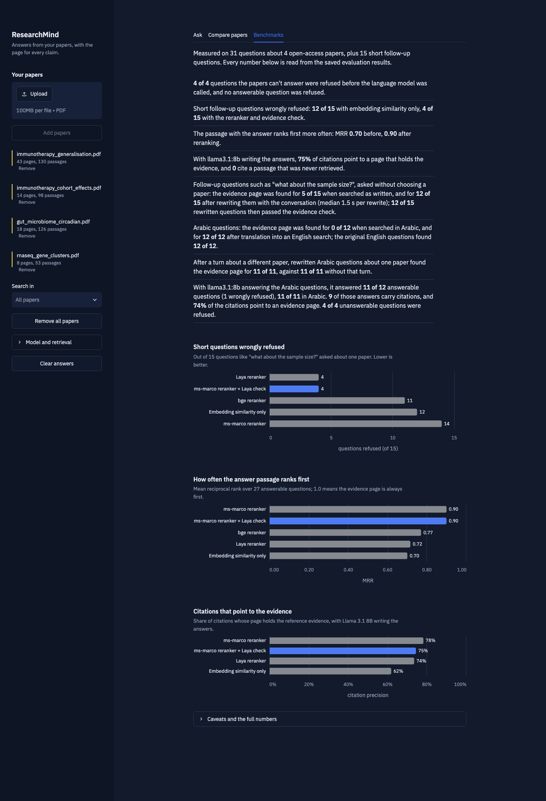
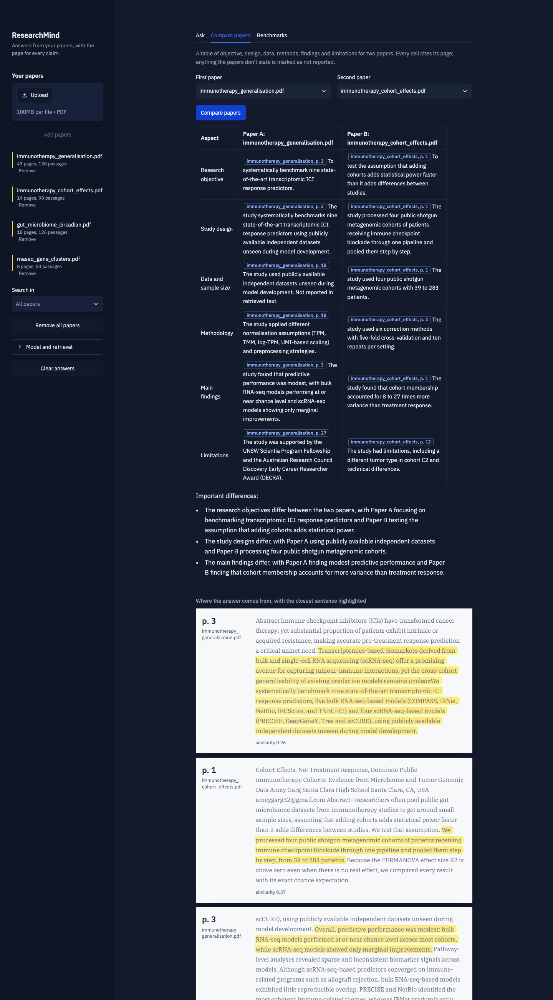
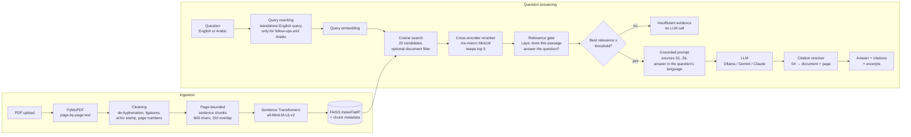

# ResearchMind AI

**An evidence-grounded research assistant for scientific papers, built with Retrieval-Augmented Generation (RAG).**

Upload research papers (PDF), ask questions in plain language, and get answers in which every claim is linked to a
document and page, with the supporting passage one click away. ResearchMind runs fully locally with
[Ollama](https://ollama.com), or with Google Gemini or Anthropic Claude if you provide an API key.

**The idea in 30 seconds** (sound on):

https://github.com/user-attachments/assets/e2b62caa-391a-4823-be6a-16ce3854f32c

*The pitch video was made with [Remotion](https://www.remotion.dev) and a free, offline voice
([Kokoro](https://huggingface.co/hexgrad/Kokoro-82M)). The app screens, paper text and numbers in it are real; the
made-up citation in the opening is a labelled example. The video file is also in the repository:
[assets/video/researchmind-pitch.mp4](assets/video/researchmind-pitch.mp4).*

**Highlights**

- **Two-stage retrieval with a relevance gate.** FAISS cosine search finds 20 candidate passages, a cross-encoder
  reranker (ms-marco MiniLM) orders them, and a separate relevance model ([Laya](https://huggingface.co/convaiinnovations/laya))
  judges whether the top passages actually answer the question.
- **A hallucination guardrail.** When no passage is judged relevant, the LLM is never called. In the evaluation this
  refused all 4 unanswerable questions and none of the 27 answerable ones.
- **Citations verified in code.** The model cites source IDs; code maps them to `[paper.pdf, Page 4]` from metadata
  stored at indexing time, so a page number cannot be invented (0 invalid citations across all runs).
- **Measured, not assumed.** 31 hand-verified questions plus 15 short follow-up questions, scored with MRR, AUROC and
  citation precision. Every number in this README comes from the evaluation script.
- **A real bug, diagnosed and fixed with data.** Short questions like *"ok what about the sample size?"* were wrongly
  refused. Comparing four rerankers showed that no single model was best at both ranking and refusing, which led to
  the ranker + gate design. See [From a bug report to a measured fix](#from-a-bug-report-to-a-measured-fix).
- **Arabic and follow-up questions.** Ask in Arabic or English, or follow up with *"ok what about the sample size?"*:
  the question is rewritten into a standalone English search query, and the answer comes back in the language you
  asked in, with citations from English papers. See [Follow-up and Arabic questions](#follow-up-and-arabic-questions).
- **It shows its work.** Under every answer, a five-step trace shows what was searched, how many passages were found,
  how they were ranked, the evidence check against its threshold, and the model's citations; the sentence each answer
  relies on is highlighted in the source passage.
- **Private by default.** With Ollama, papers, embeddings and models stay on your machine; even the fonts are
  self-hosted.



*An Arabic question about an English paper: it is searched in English (step 1 of the trace), passes the evidence
check (step 4), and is answered in Arabic with page citations; the sentences the answer relies on are highlighted.*

<details>
<summary>More screenshots</summary>

**Welcome screen**: a real example from one of the evaluation papers, and one click to load all four.



**Refusal**: an off-topic question fails the evidence check, and nothing is sent to the language model.



**A follow-up question**: *"ok what about the sample size?"* is rewritten with the conversation into "sample size in
cohort-effects study". The answer quotes two sample sizes from the paper, though the paper's headline figure (four
cohorts, 39 to 283 patients) would have been the better answer, a reminder to check the highlighted passages.



**Benchmarks tab**: the evaluation results, read from the saved result files.



**Paper comparison**: a structured table with a citation in every cell. Note one real error: the *Limitations* cell
for Paper A cites a funding statement, which is a real passage but not a limitation. Citations guarantee *where* a
claim came from, not that the passage supports it, which is why the passages are always shown.



</details>

All screenshots were captured from the running app (`llama3.1:8b` via Ollama, the ms-marco reranker and the Laya
gate, four CC BY papers) with headless Chromium; nothing was edited.

---

## Contents

- [Features](#features)
- [How it works](#how-it-works)
- [Reducing hallucinations](#reducing-hallucinations)
- [Quick start](#quick-start)
- [Configuration](#configuration)
- [Evaluation](#evaluation)
- [Testing](#testing)
- [Project structure](#project-structure)
- [Engineering decisions](#engineering-decisions)
- [Limitations](#limitations)
- [Future work](#future-work)
- [Data and licensing](#data-and-licensing)

## Features

- **Multi-PDF upload** with per-file status: indexed, duplicate, scanned (no text layer), or unreadable.
- **Question answering** over all papers or a selected subset, in English or Arabic, with follow-up questions that
  use the conversation.
- **Verified citations** shown as page tags, with each cited passage on a page slip and its closest sentence
  highlighted.
- **"How this answer was made"**: a five-step trace (read, found, ranked, checked evidence, wrote) under every answer.
- **Insufficient-evidence handling**: off-topic questions are answered as such instead of being guessed.
- **Reranking and relevance gating** (optional): a cross-encoder reorders passages, and a relevance model decides
  whether there is enough evidence to answer.
- **Paper comparison**: a structured table (objective, design, data and sample size, methods, findings, limitations) for two papers, with citations in every cell.
- **Pluggable LLMs**: Ollama (local, default), Gemini, Claude, or a no-LLM mode that returns the most relevant passages.
- **Reproducible evaluation**: 31 hand-verified questions, 15 short follow-ups, 16 Arabic questions, a retrieval
  parameter grid and end-to-end metrics, also shown in the app's **Benchmarks** tab.

## How it works



| Module | Responsibility |
|---|---|
| `src/pdf_processor.py` | Page-level extraction with PyMuPDF, text cleaning, scanned/encrypted/corrupt detection |
| `src/text_chunker.py` | Page-bounded, sentence-aware chunking with overlap; optional bibliography stripping |
| `src/embeddings.py` | Sentence Transformers wrapper (same model for documents and queries, normalised vectors) |
| `src/vector_store.py` | FAISS index with an aligned metadata list; filter, remove, save/load |
| `src/prompts.py` | System prompt, source formatting, prompt-injection neutralisation, comparison template |
| `src/citations.py` | Maps the model's `[S#]` markers to verified document/page labels; drops invalid IDs |
| `src/query_rewriter.py` | Language detection and LLM rewriting of follow-up and Arabic questions into a standalone English query |
| `src/highlight.py` | Finds the sentence of a cited passage that best matches the answer, for highlighting |
| `src/reranker.py` | Optional cross-encoder rerankers (ms-marco, bge) and the Laya relevance model behind one `score()` interface |
| `src/llm_client.py` | Ollama, Gemini, Claude and extractive clients behind one `generate()` interface, typed errors |
| `src/rag_pipeline.py` | Orchestration: ingest, retrieve, rerank, evidence check, generate, resolve citations, compare |
| `src/benchmarks.py` | Loads the saved evaluation results for the Benchmarks tab |
| `app.py`, `ui/` | Streamlit UI only: layout and state in `app.py`, HTML building blocks and styles in `ui/` |

## Reducing hallucinations

RAG reduces unsupported answers; it does not eliminate them. ResearchMind adds several safeguards and makes every
answer easy to check:

1. **Evidence first.** The LLM only sees retrieved passages and is instructed to answer from them alone, to say when a
   detail (such as a sample size or test statistic) is not reported, and to start with a fixed marker when the sources
   do not answer the question.
2. **The model never writes citations.** Passages are labelled `S1…Sk`; the model cites IDs, and `citations.py`
   replaces them with the document name and page stored at indexing time. A citation to an ID that was never
   retrieved is removed and reported as a warning, and answers without any citation are flagged.
3. **Exact page numbers.** Chunks never cross page boundaries, so the page attached to a chunk is always the page the
   text came from.
4. **Two-layer insufficient-evidence check.** If no passage clears a calibrated threshold (the relevance gate's score,
   or cosine similarity when no gate is configured), the LLM is not called at all. Otherwise, the model can still
   report insufficient evidence, which the UI shows explicitly.
5. **Documents are untrusted input.** Instructions and evidence are separated (system prompt versus `<source>` blocks),
   the prompt tells the model never to follow instructions found in sources, and tag-like text in PDFs is neutralised
   so a document cannot close its source block.
6. **Secrets stay out of the UI.** API keys are read from `.env`, never displayed, and hidden from `Settings.__repr__`.

## Quick start

Requirements: Python 3.11+, about 1.5 GB of disk for Python packages, about 2 GB for the reranker and gate models,
plus about 5 GB for a local Ollama model. Tested on macOS (Apple silicon, 16 GB RAM) with Python 3.11; with Llama 3.1
8B and the Laya gate both loaded, 16 GB is tight, so close other large apps or set `RERANK_GATE=none`.

```bash
git clone https://github.com/luba-alqaysi/researchmind-ai.git
cd researchmind-ai

# Option A: uv (fast)
uv venv --python 3.11 && source .venv/bin/activate
uv pip install -r requirements.txt

# Option B: standard venv + pip
python3.11 -m venv .venv && source .venv/bin/activate
pip install -r requirements.txt

cp .env.example .env
```

**Choose an LLM provider** (set `LLM_PROVIDER` in `.env`):

| Provider | Setup |
|---|---|
| `ollama` (default) | Install [Ollama](https://ollama.com/download), then `ollama pull llama3.1:8b`. Free, local, private. |
| `gemini` | Create a key at [Google AI Studio](https://aistudio.google.com/apikey) and set `GEMINI_API_KEY`. |
| `claude` | Create a key in the [Anthropic Console](https://console.anthropic.com) and set `ANTHROPIC_API_KEY`. |
| `extractive` | No LLM. Returns the most relevant passages with citations. |

**Run the app:**

```bash
streamlit run app.py
```

Open http://localhost:8501, upload one or more text-based PDFs in the sidebar, press **Process documents**, and ask a
question. To try it with the papers used in the evaluation:

```bash
python evaluation/download_papers.py   # four CC BY 4.0 arXiv papers -> sample_data/papers/
```

The first run downloads the embedding model (about 90 MB) from Hugging Face.

## Configuration

All settings live in `.env` (see `.env.example`; the defaults below are its values); the provider, model and top-k can
also be changed in the sidebar. If the four `RERANK*` variables are not set at all, the app uses plain cosine search,
which needs no extra model downloads. The ms-marco reranker (about 90 MB) and Laya (about 1.7 GB) are downloaded from
Hugging Face on first use; Laya needs the optional `laya` package from `requirements.txt`.

| Variable | Default | Meaning |
|---|---|---|
| `LLM_PROVIDER` | `ollama` | `ollama`, `gemini`, `claude`, or `extractive` |
| `OLLAMA_MODEL` | `llama3.1:8b` | Any model pulled into Ollama |
| `OLLAMA_NUM_CTX` | `8192` | Context window sent to Ollama (its small default would silently truncate evidence) |
| `GEMINI_MODEL` | `gemini-2.5-flash` | Gemini model ID |
| `CLAUDE_MODEL` | `claude-opus-5-5` | Or `claude-sonnet-5-5`, `claude-haiku-5-5` |
| `CLAUDE_EFFORT` | `medium` | Reasoning effort for Claude (`low`, `medium`, `high`) |
| `LLM_TEMPERATURE` | `0.1` | Ollama and Gemini only; current Claude models do not accept it |
| `EMBEDDING_MODEL` | `sentence-transformers/all-MiniLM-L6-v2` | Any Sentence Transformers model |
| `CHUNK_SIZE` / `CHUNK_OVERLAP` | `800` / `150` | Characters per chunk / carried-over characters |
| `TOP_K` | `5` | Passages retrieved per question |
| `MIN_SIMILARITY` | `0.30` | Below this best-passage similarity, answer "insufficient evidence" without calling the LLM |
| `SKIP_REFERENCES` | `true` | Drop bibliography text before indexing |
| `BALANCE_DOCUMENTS` | `true` | With several papers in scope, give each relevant paper at least one passage |
| `RERANKER` | `ms-marco` | Second-stage reranker: `none`, `ms-marco`, `bge` or `laya` |
| `RERANK_GATE` | `laya` | Separate model that judges the final passages for the evidence check; `none` lets the reranker judge |
| `RERANK_CANDIDATES` | `20` | Passages fetched by cosine search before reranking |
| `RERANK_MIN_SCORE` | `0.35` | With a reranker or gate active, this 0–1 relevance cutoff replaces `MIN_SIMILARITY` |
| `QUERY_REWRITING` | `true` | Rewrite follow-up and non-English questions into a standalone English search query (one extra LLM call) |

## Evaluation

All numbers below were produced by `evaluation/evaluate_rag.py` between 2 and 5 November 2026 (Apple M4, 16 GB RAM)
and are reproduced in [evaluation/RESULTS.md](evaluation/RESULTS.md), which the script generates. The retrieval
experiments and the first end-to-end results use plain cosine search; reranking is evaluated in
[From a bug report to a measured fix](#from-a-bug-report-to-a-measured-fix). To reproduce:

```bash
python evaluation/download_papers.py
python evaluation/evaluate_rag.py retrieval                 # no LLM needed, a few minutes
python evaluation/evaluate_rag.py generation --provider ollama
python evaluation/evaluate_rag.py rerank                    # compares rerankers and gates, no LLM needed
python evaluation/evaluate_rag.py generation --provider ollama --reranker ms-marco --rerank-gate laya --rerank-min-score 0.35
python evaluation/evaluate_rag.py rewrite --provider ollama --generate   # follow-up and Arabic questions
python evaluation/evaluate_rag.py generation --provider ollama --judge claude --judge-model claude-haiku-5-5   # optional judge
```

### Dataset

[`evaluation/evaluation_questions.csv`](evaluation/evaluation_questions.csv) contains **31 questions** over four
CC BY papers: 27 answerable questions (methodology, findings, sample size, statistics, limitations and three
cross-document questions) and 4 unanswerable ones. Each answerable question has a reference answer, the pages that
contain the evidence, and one or more short evidence phrases. Every phrase was checked programmatically to occur on its
listed page and in at least one indexed chunk.

The questions and reference answers were drafted with AI assistance from the extracted text of the papers, then checked
against the papers. After the first end-to-end run, two dataset errors were corrected: one question was ambiguous
("the gut microbiome study" also matched a second paper), and one evidence page was missing. All results below use the
corrected set.

### Metrics

| Metric | What it measures | How |
|---|---|---|
| page_hit@k | Retrieval quality | At least one retrieved chunk comes from an evidence page |
| phrase_hit@k | Retrieval quality (strict) | A retrieved chunk contains a verified evidence phrase |
| MRR | Ranking quality | Reciprocal rank of the first evidence-page chunk |
| Citation precision | Citation accuracy | Share of rendered citations whose document and page are an evidence page |
| Answers citing evidence | Citation accuracy | Share of answerable questions with at least one citation to an evidence page |
| Abstention | Handling of missing evidence | "Insufficient evidence" on unanswerable questions (should be 100%) and on answerable ones (should be 0%) |
| Latency | Responsiveness | Retrieval time and LLM generation time per question |
| Correctness, faithfulness | Answer quality | Optional LLM judge, comparing against the reference answer and the retrieved passages |

### Retrieval experiments

Top-5, bibliography stripped, per-document balancing on (27 answerable questions, all four papers searched):

| Chunk size | Overlap | Chunks | page_hit@5 | phrase_hit@5 | MRR |
|---|---|---|---|---|---|
| 400 | 0 | 742 | 0.852 | 0.259 | 0.711 |
| 400 | 150 | 986 | 0.926 | 0.370 | 0.638 |
| 800 | 0 | 361 | 0.889 | 0.407 | 0.691 |
| **800** | **150** | **407** | **0.963** | **0.333** | **0.702** |
| 1200 | 0 | 248 | 0.778 | 0.519 | 0.623 |
| 1200 | 150 | 262 | 0.889 | 0.593 | 0.704 |

Effect of top-k and of the per-document passage guarantee (800 / 150):

| Balancing | top-k | Passages returned (avg) | page_hit | phrase_hit | MRR | Cross-document coverage |
|---|---|---|---|---|---|---|
| off | 3 | 3.0 | 0.852 | 0.296 | 0.679 | 0.833 |
| on | 3 | 5.1 | 0.889 | 0.333 | 0.688 | 1.000 |
| off | 5 | 5.0 | 0.926 | 0.296 | 0.696 | 0.833 |
| **on** | **5** | **7.1** | **0.963** | **0.333** | **0.702** | **1.000** |
| off | 8 | 8.0 | 0.963 | 0.556 | 0.702 | 1.000 |
| on | 8 | 10.0 | 0.963 | 0.556 | 0.702 | 1.000 |

What the experiments show:

- **Overlap helps page-level retrieval at every chunk size** (for example 0.889 to 0.963 at 800 characters).
- **Larger chunks contain the exact evidence phrase more often** (phrase_hit 0.593 at 1200 versus 0.333 at 800), but find
  the right page less often and give the LLM more text per passage. 800 / 150 is a balanced default; 1200 / 150 is a
  reasonable alternative when answers need more context.
- **The per-document guarantee** brings cross-document coverage from 0.833 to 1.000 at top-3 and top-5, at the cost of
  about two extra passages per question. With top-8 it makes no difference.
- **Stripping the bibliography** removes 77 chunks and raises page_hit@5 from 0.926 to 0.963, while MRR drops slightly (0.713 to 0.702).
- Retrieval itself takes a few milliseconds (median 4 ms when the LLM is not running).

**Insufficient-evidence threshold.** The best-passage similarity of answerable questions ranged from 0.42 upwards, while
unanswerable questions scored 0.28 to 0.45, so similarity alone cannot separate them. A threshold of **0.30** stops 2 of
the 4 unanswerable questions before the LLM is called and rejects no answerable question; the remaining cases rely on
the model reporting insufficient evidence. The threshold was chosen on this same small set, with a wide margin below the
lowest answerable score.

### End-to-end results

Default configuration (800 / 150, top-5, balancing on, threshold 0.30), 31 questions, no errors:

| Metric | `llama3.1:8b` (Ollama) | No LLM (top-3 passages) |
|---|---|---|
| Answers with at least one citation | 100% | 100% |
| Citation precision (citations on an evidence page) | **61.9%** | 53.1% |
| Answers citing an evidence page | **92.6%** | 85.2% |
| Citations to non-existent sources | 0 | 0 |
| Unanswerable questions answered "insufficient evidence" | **4 / 4** | 2 / 4 |
| Answerable questions wrongly answered "insufficient evidence" | 0 / 27 | 0 / 27 |
| Generation time, median / 95th percentile | 9.6 s / 21.3 s | n/a |
| Truncated answers | 0 | 0 |

Citation precision below 100% does not necessarily mean a citation is wrong: evidence pages list where the reference
answer is stated, and correct supporting statements on other pages (for example in the introduction) count as misses.

**Not yet measured: answer correctness and faithfulness.** These need an LLM judge. The judged run with a separate
judge model has not been run yet (no cloud API key was available), and an attempt with Llama grading its own answers was
stopped by the system because the 16 GB machine ran out of memory. Run the command above with `--judge claude` or
`--judge gemini` to add them; they will appear in `evaluation/RESULTS.md`.

**Observations from reviewing the answers:**

- When retrieval missed the evidence, the model usually said that the sources did not contain the information rather
  than inventing it, which is the intended behaviour, but it produces an incomplete answer.
- The model sometimes cites the right page while the sentence does not match the passage closely, and answers vary
  between runs even at temperature 0.1. Citation metrics alone therefore overstate quality; a judge (or a human) is
  needed for correctness.
- The comparison feature initially returned "Not reported" for most rows because generic queries such as "What is the
  research objective?" matched funding statements. Always including each paper's abstract and phrasing the queries the
  way papers do fixed most rows; one error remains and is visible in the screenshot above.

### From a bug report to a measured fix

**The bug.** On a 12-page paper, *"ok what about the sample size?"* returned "Insufficient evidence", although the
passage stating the sample size was retrieved at rank 2. The cosine similarity of the best passage was 0.22, below
the 0.30 cutoff: a short question produces a vague embedding, so it scores low against every passage. Lowering the
cutoff would also let off-topic questions through.

**The experiment.** Rerankers read the question and a passage together, which should handle short questions better.
`python evaluation/evaluate_rag.py rerank` compares candidates on the 31 questions plus 15 short follow-up questions
(*"what about the sample size?"*, *"what are the limitations?"*, ...) asked with a single-paper filter. No LLM is involved;
each model rescores the 20 best cosine matches.

| Configuration | MRR | Exact evidence phrase in top 5 | Short questions: evidence page in top 5 | Gate AUROC | Unanswerable refused before the LLM | Short questions wrongly refused | Time per question |
|---|---|---|---|---|---|---|---|
| Cosine only (cutoff 0.30) | 0.70 | 33% | 53% | 0.98 | 2 / 4 | **12 / 15** | 5 ms |
| ms-marco MiniLM reranker | **0.90** | **70%** | **73%** | 1.00 | 4 / 4 | 14 / 15 | 0.08 s |
| bge-reranker-base | 0.77 | 70% | 53% | 0.71 | 1 / 4 | 11 / 15 | 0.48 s |
| Laya alone (ranks and judges) | 0.72 | 59% | 67% | 1.00 | 4 / 4 | 4 / 15 | 2.19 s |
| **ms-marco ranks + Laya judges** | **0.90** | **70%** | **73%** | **1.00** | **4 / 4** | **4 / 15** | **0.78 s** |

Gate AUROC measures how well the evidence score separates answerable from unanswerable questions (1.0 = perfectly).
The refusal columns use, for each model, a cutoff that refuses no answerable full-length question (0.35 for the Laya
gate); cosine-only uses its default of 0.30, where the LLM itself then declined the other 2 unanswerable questions.

**What it showed.** No single model was best at both jobs. ms-marco ranked best but scored vague questions close to 0,
so as a gate it refused nearly all of them. Laya judged relevance best, but ranked worse and was slow when scoring all
20 candidates. Splitting the jobs gets ms-marco's ranking and Laya's judgement, and because Laya now scores only the
final 5 to 8 passages, it costs about a third of Laya alone. On the original paper, the sample-size question now passes
the gate and Llama answers it with the correct numbers and page citations.

**End to end** (`llama3.1:8b` writing the answers, same 31 questions):

| Metric | Cosine only | ms-marco | Laya | **ms-marco + Laya gate** |
|---|---|---|---|---|
| Citation precision (citations on an evidence page) | 61.9% | 78.3% | 73.7% | 74.6% |
| Answers citing an evidence page | 92.6% | 92.6% | 88.9% | 92.6% |
| Answers with at least one citation | 100% | 96.3% | 92.6% | 96.3% |
| Unanswerable refused / of those, without calling the LLM | 4 / 4 (2) | 4 / 4 (4) | 4 / 4 (4) | **4 / 4 (4)** |
| Answerable questions wrongly refused | 0 / 27 | 0 / 27 | 0 / 27 | **0 / 27** |
| Citations to non-existent sources | 0 | 0 | 0 | 0 |

The hybrid keeps ms-marco's citation gains (75% against 62% for cosine only) and refuses every unanswerable question
before the LLM is called, while also answering short follow-up questions. Its ranking is identical to ms-marco's; the
small precision gap to ms-marco alone comes from which passages of other papers the gate admits and from run-to-run
variation in Llama's answers, which was not measured with repeated runs. With the gate, a question took 1.5 s of
retrieval (median) and 16 s of generation on this machine with Llama loaded.

**Caveats.** The cutoffs were chosen on the same small set, so they are optimistic; for the Laya gate any value from
0.28 to 0.50 refuses all 4 unanswerable and no answerable question, and 0.35 sits inside that range. There are only 4
unanswerable questions, Laya's probabilities were not recalibrated, and the times above were measured without the LLM
loaded (with Llama 3.1 8B also in memory, a 16 GB machine swaps and everything slows down). Most of the answers that
lost their citation wrote "According to S1" instead of "[S1]", a formatting issue that the citation parser could
accept in future.

### Follow-up and Arabic questions

The retrieval models are English-only and see one question at a time, so a follow-up such as *"ok what about the
sample size?"* or a question in Arabic is first rewritten by the LLM into one standalone English search query; the
answer is still written in the language of the question. `python evaluation/evaluate_rag.py rewrite --provider ollama
--generate` measures this with `llama3.1:8b` rewriting, the ms-marco reranker and the Laya gate (cutoff 0.35), all
four papers searched and no paper selected:

| Questions | Searched as written | After rewriting |
|---|---|---|
| 15 follow-ups, each after a first turn about the same paper: evidence page in top 5 | 5 / 15 | **12 / 15** |
| 12 answerable Arabic questions: evidence page in top 5 | 0 / 12 | **12 / 12** (English originals: 12 / 12) |
| 4 unanswerable Arabic questions refused before the LLM | 1 / 4 | **4 / 4** |
| 11 single-paper Arabic questions asked after a turn about a *different* paper | n/a | **11 / 11** |

A rewrite took 1.5 to 1.8 s (median). With Llama answering the 16 Arabic questions end to end:
- It answered 11 of the 12 answerable ones (one was wrongly refused) and wrote all 11 answers in Arabic.
- 9 of those answers carry citations, and 74% of the citations point to an evidence page (74.6% for the English set).
- It refused all 4 unanswerable questions.

**Caveats.**
- The short follow-ups searched as written passed the evidence check 15 times out of 15, although only 5 found the
  right page. A vague question can match vague passages, which is why rewriting matters even when nothing is refused.
- The Arabic questions are translations of questions in the main set, made with AI assistance for this project and
  not yet reviewed by a native speaker. A second pass reworded three ambiguous scientific terms before the run.
- 16 questions are a small set, and the rewriting model is the same small local model that writes the answers.

## Testing

```bash
uv pip install -r requirements-dev.txt     # or: pip install -r requirements-dev.txt
pytest -q                                   # unit + integration tests
pytest -q -m "not slow"                     # skip the test that loads the real embedding model
```

The tests generate their PDFs with PyMuPDF (text, blank, image-only, encrypted, corrupt) and use a deterministic fake
embedder and fake LLM, so they need no network access or API keys. One integration test loads the real embedding model
and checks semantic retrieval and that FAISS results match a NumPy brute-force reference.

## Project structure

```text
researchmind-ai/
├── app.py                      Streamlit interface (layout and state)
├── ui/                         HTML building blocks, styles and the Benchmarks tab
├── src/                        Pipeline modules (see "How it works")
├── static/fonts/               Self-hosted IBM Plex fonts (SIL Open Font License)
├── .streamlit/config.toml      Theme
├── evaluation/
│   ├── download_papers.py      Fetches the CC BY evaluation papers
│   ├── evaluation_questions.csv
│   ├── arabic_questions.csv    Arabic versions of 16 questions, linked to the English evidence
│   ├── evaluate_rag.py         Retrieval grid, end-to-end runs, report
│   ├── RESULTS.md              Generated results
│   └── results/                Summary CSV/JSON files
├── tests/                      Pytest suite
├── assets/screenshots/
├── sample_data/README.md       Paper list and licenses (PDFs are not committed)
├── .env.example
├── requirements.txt / requirements-dev.txt
└── pyproject.toml              Pytest configuration
```

## Engineering decisions

- **No framework (LangChain/LlamaIndex).** The pipeline is about 1,350 lines of plain Python (including docstrings), which keeps every step
  visible, testable and easy to explain.
- **Exact FAISS search (`IndexFlatIP`).** A few papers produce a few thousand chunks; exact search takes milliseconds,
  so approximate indexes would add tuning without benefit. Vectors are L2-normalised, so inner product equals cosine
  similarity.
- **Page-bounded chunks.** Citation accuracy matters more than perfectly contiguous context. The cost is that a paragraph
  continuing onto the next page is split.
- **Content-stream text order.** PyMuPDF blocks are read in content-stream order rather than sorted by position, which
  keeps two-column LaTeX papers in reading order.
- **Source IDs instead of model-written citations.** Smaller local models often format citations inconsistently or invent
  page numbers. Resolving `[S#]` markers in code makes citations correct by construction (correct *relevance* is
  still measured in the evaluation).
- **Per-document passage guarantee.** For cross-paper questions, plain top-k often returns passages from a single paper.
  When several papers are in scope, each paper whose best passage clears the threshold gets at least one slot.
- **Ranking and gating are separate jobs.** A good ranker puts the right passage first; a good gate tells "this
  question is answerable from these passages" from "it is not". The evaluation showed that no single model was best at
  both, so the pipeline accepts one model for each (see [From a bug report to a measured fix](#from-a-bug-report-to-a-measured-fix)).
  The gate only scores the final top-k passages, which keeps a large gate model affordable.
- **Query rewriting instead of multilingual embeddings.** The measured retrieval stack (MiniLM, ms-marco, Laya) is
  English-only. Rather than replacing it, the LLM rewrites follow-up and Arabic questions into one standalone English
  query, which also fixes follow-ups that make no sense on their own. The cost is one extra LLM call, made only when
  needed, and a dependence on the model's translation; both are measured.
- **The typeface shows who is speaking.** In the interface, text quoted from a paper is set in a serif on a light page
  slip, while the assistant's words are in a sans serif on the dark background, and the highlighter colour is used
  only for evidence. The design was planned with a written brief and reviewed against screenshots of the running app.
- **Embedding model in `st.cache_resource`, index in `st.session_state`.** The model loads once per server; each browser
  session has its own document library, and repeated questions never re-embed or rebuild anything.
- **macOS OpenMP workaround.** The faiss-cpu and PyTorch wheels each ship `libomp`, and loading both aborts the process on
  macOS. `src/__init__.py` sets `KMP_DUPLICATE_LIB_OK=TRUE` on macOS only; a test checks that FAISS results still match
  a NumPy reference with the real model loaded. PyTorch is imported before FAISS on macOS, because the other order
  crashes the process when a Transformers model (the Laya gate) loads afterwards.

## Limitations

- **Text-based PDFs only.** Scanned PDFs are detected and reported, but OCR is not implemented.
- **Tables, figures and equations** are extracted as plain text (or not at all for figures), so questions that depend on
  them may be answered poorly.
- **Follow-ups and Arabic depend on the LLM's rewrite.** A poor translation or a misread reference sends the search in
  the wrong direction; the trace shows the query that was actually searched. Without an LLM (extractive mode),
  questions are searched as written.
- **First-stage retrieval is purely semantic.** Exact terms (gene names, accession numbers) can be missed by the small
  embedding model, and the reranker can only reorder what that search found; hybrid keyword + vector search would help.
- **Grounding is not verification.** Citations are guaranteed to point at a retrieved passage, but the passage may not fully
  support the sentence it is attached to. The evaluation measures this, and the UI shows excerpts so users can check.
- **Small evaluation set.** 31 questions over four papers, written for this project. The similarity threshold was tuned on
  the same set. Results indicate behaviour; they are not a benchmark.
- **Session-scoped storage.** The index lives in memory for the browser session; nothing is persisted between restarts
  (`VectorStore.save/load` exists but is not wired into the UI).

## Future work

- Hybrid BM25 + vector retrieval.
- Recalibrating the gate's probabilities on a larger, held-out question set.
- Native multilingual retrieval (for example a multilingual embedding model and reranker) to compare with rewriting.
- OCR (for example Tesseract) for scanned PDFs, and table-aware extraction.
- Sentence-level claim verification (NLI) to flag citations that do not support their sentence.
- Streaming responses in the UI.
- A larger, independently annotated evaluation set.

## Data and licensing

The code is released under the [MIT License](LICENSE). The evaluation uses four arXiv papers released under CC BY 4.0
(listed with attribution in [sample_data/README.md](sample_data/README.md)); they are downloaded by a script and are not
redistributed in this repository. No user-uploaded document is written to disk. The IBM Plex fonts in `static/fonts/` are
released under the SIL Open Font License 1.1 (`static/fonts/OFL.txt`).
