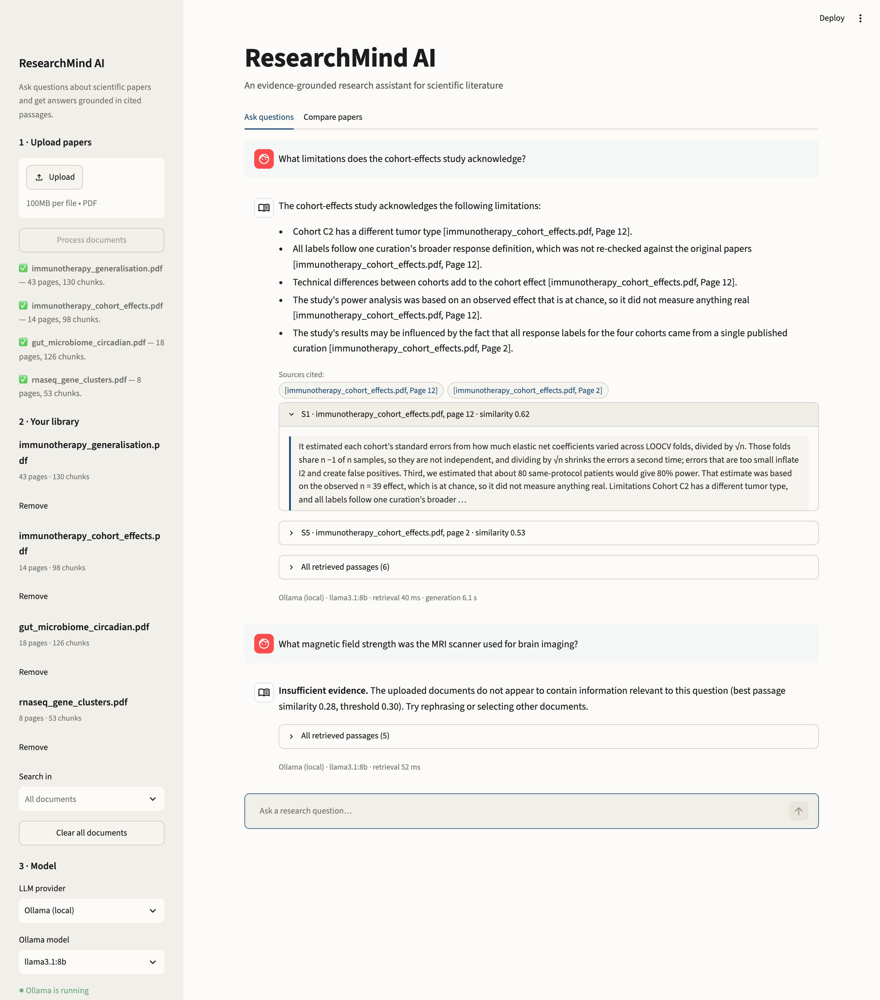
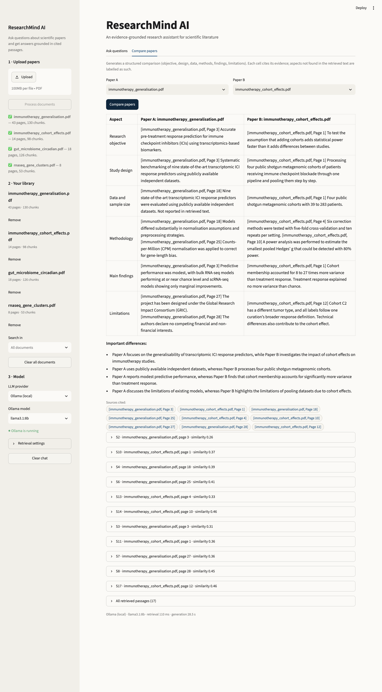
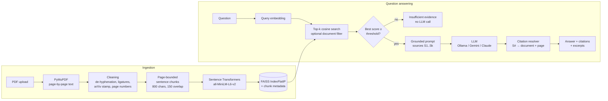

# ResearchMind AI

**An evidence-grounded research assistant for scientific papers, built with Retrieval-Augmented Generation (RAG).**

Upload research papers (PDF), ask questions in plain language, and get answers in which every claim is linked to a
document and page, with the supporting passage one click away. ResearchMind runs fully locally with
[Ollama](https://ollama.com), or with Google Gemini or Anthropic Claude if you provide an API key.


<details>
<summary>More screenshots</summary>

**Insufficient evidence**: an off-topic question is answered as such, without calling the LLM.



**Paper comparison**: a structured table with a citation in every cell. Note one real error: the *Limitations* cell
for Paper A cites funding and competing-interest statements, which are real passages but not limitations. Citations
guarantee *where* a claim came from, not that the passage supports it, which is why excerpts are always shown.



**Welcome screen**


</details>

All screenshots were captured from the running app (`llama3.1:8b` via Ollama, four CC BY papers) with a headless
browser; nothing was edited.

---

## Contents

- [Features](#features)
- [How it works](#how-it-works)
- [Reducing hallucinations](#reducing-hallucinations)
- [Quick start](#quick-start)
- [Configuration](#configuration)
- [Evaluation](#evaluation)
- [Testing](#testing)
- [Project structure](#project-structure)
- [Engineering decisions](#engineering-decisions)
- [Limitations](#limitations)
- [Future work](#future-work)
- [Data and licensing](#data-and-licensing)

## Features

- **Multi-PDF upload** with per-file status: indexed, duplicate, scanned (no text layer), or unreadable.
- **Question answering** over all papers or a selected subset, with a chat history for the session.
- **Verified citations** in the form `[paper.pdf, Page 4]`, plus expandable supporting excerpts and similarity scores.
- **Insufficient-evidence handling**: off-topic questions are answered as such instead of being guessed.
- **Paper comparison**: a structured table (objective, design, data and sample size, methods, findings, limitations) for two papers, with citations in every cell.
- **Pluggable LLMs**: Ollama (local, default), Gemini, Claude, or a no-LLM mode that returns the most relevant passages.
- **Reproducible evaluation**: 31 hand-verified questions, a retrieval parameter grid, and end-to-end metrics.

## How it works



| Module | Responsibility |
|---|---|
| `src/pdf_processor.py` | Page-level extraction with PyMuPDF, text cleaning, scanned/encrypted/corrupt detection |
| `src/text_chunker.py` | Page-bounded, sentence-aware chunking with overlap; optional bibliography stripping |
| `src/embeddings.py` | Sentence Transformers wrapper (same model for documents and queries, normalised vectors) |
| `src/vector_store.py` | FAISS index with an aligned metadata list; filter, remove, save/load |
| `src/prompts.py` | System prompt, source formatting, prompt-injection neutralisation, comparison template |
| `src/citations.py` | Maps the model's `[S#]` markers to verified document/page labels; drops invalid IDs |
| `src/llm_client.py` | Ollama, Gemini, Claude and extractive clients behind one `generate()` interface, typed errors |
| `src/rag_pipeline.py` | Orchestration: ingest, retrieve, threshold check, generate, resolve citations, compare |
| `app.py` | Streamlit UI only; contains no retrieval or generation logic |

## Reducing hallucinations

RAG reduces unsupported answers; it does not eliminate them. ResearchMind adds several safeguards and makes every
answer easy to check:

1. **Evidence first.** The LLM only sees retrieved passages and is instructed to answer from them alone, to say when a
   detail (such as a sample size or test statistic) is not reported, and to start with a fixed marker when the sources
   do not answer the question.
2. **The model never writes citations.** Passages are labelled `S1…Sk`; the model cites IDs, and `citations.py`
   replaces them with the document name and page stored at indexing time. A citation to an ID that was never
   retrieved is removed and reported as a warning, and answers without any citation are flagged.
3. **Exact page numbers.** Chunks never cross page boundaries, so the page attached to a chunk is always the page the
   text came from.
4. **Two-layer insufficient-evidence check.** If the best passage is below a calibrated similarity threshold, the LLM is
   not called at all. Otherwise, the model can still report insufficient evidence, which the UI shows explicitly.
5. **Documents are untrusted input.** Instructions and evidence are separated (system prompt versus `<source>` blocks),
   the prompt tells the model never to follow instructions found in sources, and tag-like text in PDFs is neutralised
   so a document cannot close its source block.
6. **Secrets stay out of the UI.** API keys are read from `.env`, never displayed, and hidden from `Settings.__repr__`.

## Quick start

Requirements: Python 3.11+, about 1.5 GB of disk for Python packages, plus about 5 GB for a local Ollama model.
Tested on macOS (Apple silicon) with Python 3.11.

```bash
git clone https://github.com/<your-username>/researchmind-ai.git
cd researchmind-ai

# Option A: uv (fast)
uv venv --python 3.11 && source .venv/bin/activate
uv pip install -r requirements.txt

# Option B: standard venv + pip
python3.11 -m venv .venv && source .venv/bin/activate
pip install -r requirements.txt

cp .env.example .env
```

**Choose an LLM provider** (set `LLM_PROVIDER` in `.env`):

| Provider | Setup |
|---|---|
| `ollama` (default) | Install [Ollama](https://ollama.com/download), then `ollama pull llama3.1:8b`. Free, local, private. |
| `gemini` | Create a key at [Google AI Studio](https://aistudio.google.com/apikey) and set `GEMINI_API_KEY`. |
| `claude` | Create a key in the [Anthropic Console](https://console.anthropic.com) and set `ANTHROPIC_API_KEY`. |
| `extractive` | No LLM. Returns the most relevant passages with citations. |

**Run the app:**

```bash
streamlit run app.py
```

Open http://localhost:8501, upload one or more text-based PDFs in the sidebar, press **Process documents**, and ask a
question. To try it with the papers used in the evaluation:

```bash
python evaluation/download_papers.py   # four CC BY 4.0 arXiv papers -> sample_data/papers/
```

The first run downloads the embedding model (about 90 MB) from Hugging Face.

## Configuration

All settings live in `.env` (see `.env.example`); the provider, model and top-k can also be changed in the sidebar.

| Variable | Default | Meaning |
|---|---|---|
| `LLM_PROVIDER` | `ollama` | `ollama`, `gemini`, `claude`, or `extractive` |
| `OLLAMA_MODEL` | `llama3.1:8b` | Any model pulled into Ollama |
| `OLLAMA_NUM_CTX` | `8192` | Context window sent to Ollama (its small default would silently truncate evidence) |
| `GEMINI_MODEL` | `gemini-2.5-flash` | Gemini model ID |
| `CLAUDE_MODEL` | `claude-opus-5-5` | Or `claude-sonnet-5-5`, `claude-haiku-5-5` |
| `CLAUDE_EFFORT` | `medium` | Reasoning effort for Claude (`low`, `medium`, `high`) |
| `LLM_TEMPERATURE` | `0.1` | Ollama and Gemini only; current Claude models do not accept it |
| `EMBEDDING_MODEL` | `sentence-transformers/all-MiniLM-L6-v2` | Any Sentence Transformers model |
| `CHUNK_SIZE` / `CHUNK_OVERLAP` | `800` / `150` | Characters per chunk / carried-over characters |
| `TOP_K` | `5` | Passages retrieved per question |
| `MIN_SIMILARITY` | `0.30` | Below this best-passage similarity, answer "insufficient evidence" without calling the LLM |
| `SKIP_REFERENCES` | `true` | Drop bibliography text before indexing |
| `BALANCE_DOCUMENTS` | `true` | With several papers in scope, give each relevant paper at least one passage |

## Evaluation

All numbers below were produced by `evaluation/evaluate_rag.py` on 2 November 2026 (Apple M4, 16 GB RAM) and are
reproduced in [evaluation/RESULTS.md](evaluation/RESULTS.md), which the script generates. To reproduce:

```bash
python evaluation/download_papers.py
python evaluation/evaluate_rag.py retrieval                 # no LLM needed, a few minutes
python evaluation/evaluate_rag.py generation --provider ollama
python evaluation/evaluate_rag.py generation --provider ollama --judge claude --judge-model claude-haiku-5-5   # optional judge
```

### Dataset

[`evaluation/evaluation_questions.csv`](evaluation/evaluation_questions.csv) contains **31 questions** over four
CC BY papers: 27 answerable questions (methodology, findings, sample size, statistics, limitations and three
cross-document questions) and 4 unanswerable ones. Each answerable question has a reference answer, the pages that
contain the evidence, and one or more short evidence phrases. Every phrase was checked programmatically to occur on its
listed page and in at least one indexed chunk.

The questions and reference answers were drafted with AI assistance from the extracted text of the papers, then checked
against the papers. After the first end-to-end run, two dataset errors were corrected: one question was ambiguous
("the gut microbiome study" also matched a second paper), and one evidence page was missing. All results below use the
corrected set.

### Metrics

| Metric | What it measures | How |
|---|---|---|
| page_hit@k | Retrieval quality | At least one retrieved chunk comes from an evidence page |
| phrase_hit@k | Retrieval quality (strict) | A retrieved chunk contains a verified evidence phrase |
| MRR | Ranking quality | Reciprocal rank of the first evidence-page chunk |
| Citation precision | Citation accuracy | Share of rendered citations whose document and page are an evidence page |
| Answers citing evidence | Citation accuracy | Share of answerable questions with at least one citation to an evidence page |
| Abstention | Handling of missing evidence | "Insufficient evidence" on unanswerable questions (should be 100%) and on answerable ones (should be 0%) |
| Latency | Responsiveness | Retrieval time and LLM generation time per question |
| Correctness, faithfulness | Answer quality | Optional LLM judge, comparing against the reference answer and the retrieved passages |

### Retrieval experiments

Top-5, bibliography stripped, per-document balancing on (27 answerable questions, all four papers searched):

| Chunk size | Overlap | Chunks | page_hit@5 | phrase_hit@5 | MRR |
|---|---|---|---|---|---|
| 400 | 0 | 742 | 0.852 | 0.259 | 0.711 |
| 400 | 150 | 986 | 0.926 | 0.370 | 0.638 |
| 800 | 0 | 361 | 0.889 | 0.407 | 0.691 |
| **800** | **150** | **407** | **0.963** | **0.333** | **0.702** |
| 1200 | 0 | 248 | 0.778 | 0.519 | 0.623 |
| 1200 | 150 | 262 | 0.889 | 0.593 | 0.704 |

Effect of top-k and of the per-document passage guarantee (800 / 150):

| Balancing | top-k | Passages returned (avg) | page_hit | phrase_hit | MRR | Cross-document coverage |
|---|---|---|---|---|---|---|
| off | 3 | 3.0 | 0.852 | 0.296 | 0.679 | 0.833 |
| on | 3 | 5.1 | 0.889 | 0.333 | 0.688 | 1.000 |
| off | 5 | 5.0 | 0.926 | 0.296 | 0.696 | 0.833 |
| **on** | **5** | **7.1** | **0.963** | **0.333** | **0.702** | **1.000** |
| off | 8 | 8.0 | 0.963 | 0.556 | 0.702 | 1.000 |
| on | 8 | 10.0 | 0.963 | 0.556 | 0.702 | 1.000 |

What the experiments show:

- **Overlap helps page-level retrieval at every chunk size** (for example 0.889 to 0.963 at 800 characters).
- **Larger chunks contain the exact evidence phrase more often** (phrase_hit 0.593 at 1200 versus 0.333 at 800), but find
  the right page less often and give the LLM more text per passage. 800 / 150 is a balanced default; 1200 / 150 is a
  reasonable alternative when answers need more context.
- **The per-document guarantee** brings cross-document coverage from 0.833 to 1.000 at top-3 and top-5, at the cost of
  about two extra passages per question. With top-8 it makes no difference.
- **Stripping the bibliography** removes 77 chunks and raises page_hit@5 from 0.926 to 0.963, while MRR drops slightly (0.713 to 0.702).
- Retrieval itself takes a few milliseconds (median 4 ms when the LLM is not running).

**Insufficient-evidence threshold.** The best-passage similarity of answerable questions ranged from 0.42 upwards, while
unanswerable questions scored 0.28 to 0.45, so similarity alone cannot separate them. A threshold of **0.30** stops 2 of
the 4 unanswerable questions before the LLM is called and rejects no answerable question; the remaining cases rely on
the model reporting insufficient evidence. The threshold was chosen on this same small set, with a wide margin below the
lowest answerable score.

### End-to-end results

Default configuration (800 / 150, top-5, balancing on, threshold 0.30), 31 questions, no errors:

| Metric | `llama3.1:8b` (Ollama) | No LLM (top-3 passages) |
|---|---|---|
| Answers with at least one citation | 100% | 100% |
| Citation precision (citations on an evidence page) | **61.9%** | 53.1% |
| Answers citing an evidence page | **92.6%** | 85.2% |
| Citations to non-existent sources | 0 | 0 |
| Unanswerable questions answered "insufficient evidence" | **4 / 4** | 2 / 4 |
| Answerable questions wrongly answered "insufficient evidence" | 0 / 27 | 0 / 27 |
| Generation time, median / 95th percentile | 9.6 s / 21.3 s | n/a |
| Truncated answers | 0 | 0 |

Citation precision below 100% does not necessarily mean a citation is wrong: evidence pages list where the reference
answer is stated, and correct supporting statements on other pages (for example in the introduction) count as misses.

**Not yet measured: answer correctness and faithfulness.** These need an LLM judge. The judged run with a separate
judge model has not been run yet (no cloud API key was available), and an attempt with Llama grading its own answers was
stopped by the system because the 16 GB machine ran out of memory. Run the command above with `--judge claude` or
`--judge gemini` to add them; they will appear in `evaluation/RESULTS.md`.

**Observations from reviewing the answers:**

- When retrieval missed the evidence, the model usually said that the sources did not contain the information rather
  than inventing it, which is the intended behaviour, but it produces an incomplete answer.
- The model sometimes cites the right page while the sentence does not match the passage closely, and answers vary
  between runs even at temperature 0.1. Citation metrics alone therefore overstate quality; a judge (or a human) is
  needed for correctness.
- The comparison feature initially returned "Not reported" for most rows because generic queries such as "What is the
  research objective?" matched funding statements. Always including each paper's abstract and phrasing the queries the
  way papers do fixed most rows; one error remains and is visible in the screenshot above.

## Testing

```bash
uv pip install -r requirements-dev.txt     # or: pip install -r requirements-dev.txt
pytest -q                                   # unit + integration tests
pytest -q -m "not slow"                     # skip the test that loads the real embedding model
```

The tests generate their PDFs with PyMuPDF (text, blank, image-only, encrypted, corrupt) and use a deterministic fake
embedder and fake LLM, so they need no network access or API keys. One integration test loads the real embedding model
and checks semantic retrieval and that FAISS results match a NumPy brute-force reference.

## Project structure

```text
researchmind-ai/
├── app.py                      Streamlit interface
├── src/                        Pipeline modules (see "How it works")
├── evaluation/
│   ├── download_papers.py      Fetches the CC BY evaluation papers
│   ├── evaluation_questions.csv
│   ├── evaluate_rag.py         Retrieval grid, end-to-end runs, report
│   ├── RESULTS.md              Generated results
│   └── results/                Summary CSV/JSON files
├── tests/                      Pytest suite
├── assets/screenshots/
├── sample_data/README.md       Paper list and licenses (PDFs are not committed)
├── .env.example
├── requirements.txt / requirements-dev.txt
└── pyproject.toml              Pytest configuration
```

## Engineering decisions

- **No framework (LangChain/LlamaIndex).** The pipeline is about 1,350 lines of plain Python (including docstrings), which keeps every step
  visible, testable and easy to explain.
- **Exact FAISS search (`IndexFlatIP`).** A few papers produce a few thousand chunks; exact search takes milliseconds,
  so approximate indexes would add tuning without benefit. Vectors are L2-normalised, so inner product equals cosine
  similarity.
- **Page-bounded chunks.** Citation accuracy matters more than perfectly contiguous context. The cost is that a paragraph
  continuing onto the next page is split.
- **Content-stream text order.** PyMuPDF blocks are read in content-stream order rather than sorted by position, which
  keeps two-column LaTeX papers in reading order.
- **Source IDs instead of model-written citations.** Smaller local models often format citations inconsistently or invent
  page numbers. Resolving `[S#]` markers in code makes citations correct by construction (correct *relevance* is
  still measured in the evaluation).
- **Per-document passage guarantee.** For cross-paper questions, plain top-k often returns passages from a single paper.
  When several papers are in scope, each paper whose best passage clears the threshold gets at least one slot.
- **Embedding model in `st.cache_resource`, index in `st.session_state`.** The model loads once per server; each browser
  session has its own document library, and repeated questions never re-embed or rebuild anything.
- **macOS OpenMP workaround.** The faiss-cpu and PyTorch wheels each ship `libomp`, and loading both aborts the process on
  macOS. `src/__init__.py` sets `KMP_DUPLICATE_LIB_OK=TRUE` on macOS only; a test checks that FAISS results still match
  a NumPy reference with the real model loaded.

## Limitations

- **Text-based PDFs only.** Scanned PDFs are detected and reported, but OCR is not implemented.
- **Tables, figures and equations** are extracted as plain text (or not at all for figures), so questions that depend on
  them may be answered poorly.
- **Each question is answered independently.** The chat history is for display; follow-up questions such as "and its
  limitations?" are not rewritten using earlier turns.
- **Retrieval is purely semantic.** Exact terms (gene names, accession numbers) can be missed by the small embedding model;
  hybrid keyword + vector search would help.
- **Grounding is not verification.** Citations are guaranteed to point at a retrieved passage, but the passage may not fully
  support the sentence it is attached to. The evaluation measures this, and the UI shows excerpts so users can check.
- **Small evaluation set.** 31 questions over four papers, written for this project. The similarity threshold was tuned on
  the same set. Results indicate behaviour; they are not a benchmark.
- **Session-scoped storage.** The index lives in memory for the browser session; nothing is persisted between restarts
  (`VectorStore.save/load` exists but is not wired into the UI).

## Future work

- Hybrid BM25 + vector retrieval and a cross-encoder re-ranker.
- Query rewriting for conversational follow-ups.
- OCR (for example Tesseract) for scanned PDFs, and table-aware extraction.
- Sentence-level claim verification (NLI) to flag citations that do not support their sentence.
- Streaming responses in the UI.
- A larger, independently annotated evaluation set.

## Data and licensing

The code is released under the [MIT License](LICENSE). The evaluation uses four arXiv papers released under CC BY 4.0
(listed with attribution in [sample_data/README.md](sample_data/README.md)); they are downloaded by a script and are not
redistributed in this repository. No user-uploaded document is written to disk.
